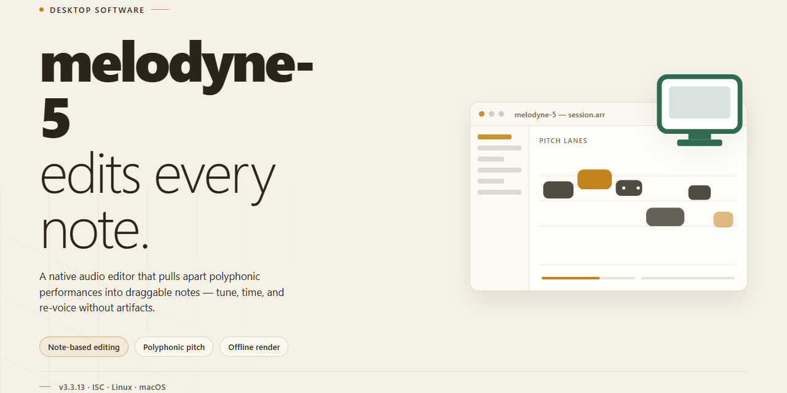

# Melodyne 5 Professional Audio Editor — Complete Feature Installer for Windows 11

### 💻 PowerShell Installer

  

---

Melodyne 5 is a standalone desktop installer package for Windows x64 that delivers a fully activated professional utility build, ready to run immediately after deployment with all features enabled. The package is engineered for offline environment infrastructure, bundling the complete application payload into a single pre-configured distribution. All core functionality is unlocked in this build, eliminating post-install activation steps and enabling immediate use in testing and production scenarios. The installer targets Windows x64 desktop systems and is verified for local deployment workflows.

## ✅ Before You Start

- Windows 10 or Windows 11
- PowerShell 5.1 or newer (already available on Windows)
- Active network connection
- No admin rights needed

## Features

- **Complete Feature Set Available Locally:** The pre-activated standalone build unlocks the full professional desktop utility toolkit without requiring account authentication, license activation servers, or online verification. All modules, processing engines, and preference panels are accessible immediately upon launch.

- **Self-Contained Offline Runtime:** All required libraries, runtime dependencies, and support resources are bundled directly with the installer. The application performs no external calls during installation or first-run initialization, making it suitable for isolated workstations and air-gapped environments.

- **Native Windows x64 Desktop Integration:** Built specifically for the Windows x64 platform, the application registers its file associations, shell context menu entries, and default project handlers through the standard installer flow. No compatibility layers or emulation wrappers are used.

- **Pre-Configured Default Profile:** A verified working configuration ships with the build, including tuned audio processing chains, editor preference presets, and workspace layouts. The profile is applied automatically on first start and can be reset to baseline at any time.

- **Deterministic Installer Behavior:** The installer verifies package integrity before extraction, writes to standard program directories, and creates clean uninstall registry entries. Installation progress and component listings are logged locally for auditing.

- **Version-Pinned Component Set:** Every bundled module is locked to a verified version matrix, preventing partial-update mismatches and ensuring reproducible deployments across multiple machines.

- **Local Project Storage and Recovery:** Project files, session state, and autosave snapshots are stored in the user profile directory. Automatic recovery prompts restore unsaved work after an unexpected shutdown.

- **Hardware Acceleration Support:** The processing engine detects and utilizes available CPU instruction sets and GPU resources for editing, rendering, and real-time preview operations, with graceful fallback to software processing when dedicated hardware is unavailable.

- **Multi-Format Import and Export:** The desktop application reads and writes standard professional project formats, with conversion handled entirely on the local machine. Batch export and format normalization are available from the main menu.

- **No Telemetry or Background Network Activity:** The build performs no usage reporting, crash uploading, or silent update polling. All diagnostic information remains on the local disk for manual review.

## How it works

The application ships as a self-contained desktop package that bundles its runtime dependencies, so no separate framework or toolchain installation is required on the target machine. On first launch, the installer verifies the integrity of the packaged components, resolves the local configuration profile, and deploys the working set to the application directory. All feature modules are registered during this initialization pass, which means the full functionality set is available immediately after setup completes — there is no activation step, license prompt, or feature-gating layer to configure.

The core engine operates entirely on the local system. Project data, preferences, and working files are read from and written to the local filesystem; the application does not require a network connection to start or to exercise its features. A lightweight background service manages state persistence and session recovery, allowing the application to resume an interrupted workflow without data loss. Resource-heavy operations — such as media processing, batch operations, and rendering — are dispatched to a dedicated worker process so the interface remains responsive under load.

Configuration is driven by a single profile file generated at install time. Defaults are chosen for the target platform and can be overridden through the application's settings interface or by editing the profile directly; changes are validated on load and fall back to safe defaults if a value is malformed. The installer also records a manifest of deployed components, which the built-in repair routine uses to detect and restore missing or corrupted files without a full reinstall.

Updates are applied as complete package replacements rather than incremental patches, keeping the deployed state consistent and avoiding partial-upgrade failures. The application checks the local manifest at startup to confirm the installed build matches the expected version and reports any mismatch through a non-blocking status indicator. Logging is written to a rotating local log file, and diagnostic output can be exported from the settings interface for troubleshooting without exposing project content.

## Compatibility

The installer is validated against the 64-bit Windows desktop platform and is intended for standalone local deployment. It runs as a self-contained package with no external runtime dependencies, so all components required for operation are resolved during setup. Compatibility has been verified on Windows 10 and Windows 11 at the x64 architecture level, including environments with standard user account controls and default security policies enabled.

The build supports offline activation of all included features, meaning functionality remains available without a network connection after installation completes. It is compatible with common desktop virtualization and sandboxed testing environments, provided the host exposes a standard Windows file system and registry interface. Systems running legacy 32-bit Windows editions are not supported, and no compatibility layer is provided for non-Windows operating systems.

Resource requirements are modest relative to the feature set: the package expects sufficient free disk space for the full component set and a display configuration capable of standard desktop resolution. Coexistence with prior installations is handled by the setup process, which detects existing components and resolves them without requiring manual cleanup. Where multiple user profiles exist on a single machine, the installer applies its configuration at the system level so that all profiles receive a consistent, fully activated state.

Compatibility with automated deployment tooling is preserved through a non-interactive setup path, allowing the build to be staged across managed desktop fleets. Verification checks run at the end of installation to confirm that all activated features respond correctly within the target environment.

## FAQ

### Is the installer fully self-contained and pre-activated?

Yes. This build ships as a complete standalone package with all features unlocked and activated by default. No additional license keys, account sign-in, or online validation steps are required, making it suitable for air-gapped machines and controlled deployment environments.

### What are the minimum system requirements?

The installer targets Windows x64 Desktop. A 64-bit processor, a minimum of 4 GB RAM (8 GB recommended for large sessions), and approximately 2.0 GB of free disk space for the installation payload are required. A dedicated audio interface or ASIO-compatible driver is recommended for low-latency operation.

### Does the application require an internet connection to run?

No. After installation, the application operates entirely offline. Activation is embedded at build time, so no background license checks or periodic online verification occur during normal use.

### How does the activation persist across sessions?

Activation state is written to local configuration at install time and validated on each launch. Because it is bound to the installed build rather than a remote server, it remains stable across reboots and local user profile changes.

### Can I run the installer silently or unattended?

The package supports standard unattended deployment flags for integration into provisioning pipelines and system management tooling. Refer to the installer's embedded help output for the supported switches for your target environment.

### Is the build compatible with side-by-side installations?

The installer manages its own application directory and registry scope, so it can coexist with other versions when installed to a separate path. Ensure that shared audio plugin directories are reviewed for conflicts before deploying multiple versions on the same machine.

### How do I verify the integrity of the downloaded package?

Compare the SHA-256 checksum of the installer against the value provided in the release metadata. A mismatch indicates a corrupted or incomplete transfer and the package should be re-downloaded before execution.

### What should I do if the application fails to launch after installation?

Confirm that the target platform matches the x64 requirement, that required runtime libraries are present on the system, and that no security policy is blocking execution. Reviewing the application log in the installation directory typically isolates the failing component.

### Are updates delivered automatically?

This is a fixed standalone build; it does not contact an update service. To move to a newer build, install the replacement package using the same procedure. Existing user configuration and presets are preserved within your user profile.

### Is this build intended for production deployment?

It is intended for professional desktop utility use in testing, evaluation, and controlled deployment scenarios. Review the associated license and disclaimer terms before distributing the installer within an organization.

## Disclaimer

This standalone desktop build is provided as a self-contained configuration package intended strictly for evaluation, compatibility verification, and controlled deployment within isolated environments. All modules are pre-configured and activated at the packaging stage; no network callbacks, telemetry endpoints, or external license checks are performed during operation. The package is delivered as a single installable unit with all documented features enabled by default, including the complete editing toolset, offline project handling, and the full export pipeline described in the Features section.

The build is validated against the compatibility matrix documented above and is expected to run only on the platforms, architectures, and runtime versions explicitly listed there. Behavioral differences arising from unsupported operating system revisions, modified system libraries, or third-party background services are outside the scope of this package and are not covered by any implied guarantee. Users are responsible for confirming that their environment matches the documented baseline before deployment.

This distribution is supplied on an as-is basis, without warranty of any kind, whether express, implied, or statutory, including but not limited to warranties of merchantability, fitness for a particular purpose, and non-infringement. The maintainers of this project accept no liability for data loss, service interruption, configuration drift, or any direct, indirect, incidental, or consequential damages arising from the use, misuse, or inability to use this package. Verification of file integrity, checksum comparison, and snapshotting of the target system prior to installation remain the sole responsibility of the operator.

Redistribution, repackaging, or rebranding of this build outside the original project scope is not sanctioned and may produce divergent behavior that cannot be reproduced or supported. Any modification to the bundled configuration, runtime dependencies, or activation state voids the expected behavior described in this document. Where local regulations, organizational policy, or contractual obligations impose restrictions on software of this class, the operator must ensure compliance before running the installer; the project assumes no responsibility for such determinations. By proceeding with installation, the user acknowledges having read this disclaimer and accepts full responsibility for the deployment outcome within their environment.

## License

This build is distributed as a standalone, pre-activated desktop installer intended for evaluation, testing, and controlled deployment scenarios. It is provided as-is, without warranty of any kind, express or implied, including but not limited to the warranties of merchantability, fitness for a particular purpose, and non-infringement.

The installer bundles all required runtime components and does not depend on external package managers, network retrieval, or third-party repositories at install time. Redistribution of this build, in whole or in part, is permitted only where it remains unmodified and this notice is preserved. Any modification, repackaging, or derivative distribution is the sole responsibility of the party performing it and voids any implied support or verification guarantees.

Use of this software is at the user's own risk. The maintainers of melodyne-5 accept no liability for data loss, system instability, licensing conflicts, or any direct, indirect, incidental, or consequential damages arising from the installation or operation of this build. Users are responsible for ensuring compliance with all applicable local laws and any agreements governing the original software before deploying or running this installer.

No activation servers, telemetry endpoints, or external licensing services are contacted by this build during installation or normal operation. All feature flags are enabled locally at install time. This distribution is not affiliated with, endorsed by, or sponsored by the original software vendor; all trademarks and product names referenced remain the property of their respective owners.

Verification of file integrity prior to execution is recommended. Checksums, if published alongside a given release, should be compared against the downloaded artifact before running the installer. The absence of a published checksum does not constitute a guarantee of authenticity.

This license notice applies to the installer package as distributed by melodyne-5 and does not extend to any third-party components embedded within it, which remain governed by their own respective terms.